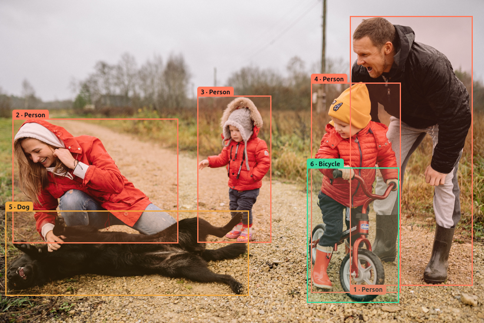
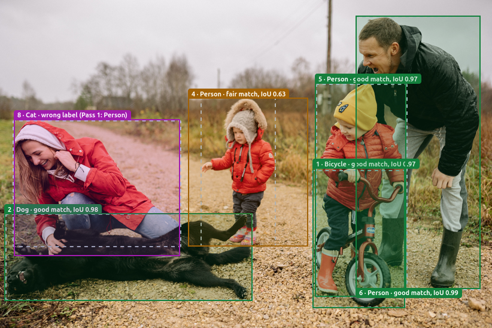
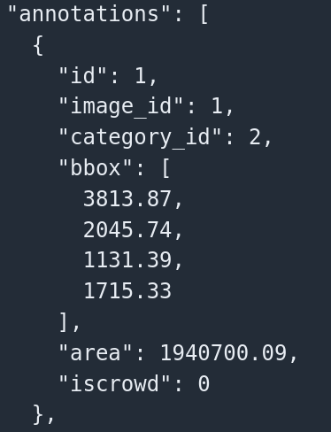

# Image Annotation Practice Tool

A simple browser tool to practice image annotation. It runs fully in the browser. No backend, no API key, no install.

**Live demo:** https://mdshahedulislamsaim.github.io/image-annotation-practice-tool/

## Screenshots

**Drawing and labeling boxes**


**Review mode: Pass 1 compared with Pass 2 on the same photo**


**COCO JSON export**


Photo by Yan Krukov on [Pexels](https://www.pexels.com/photo/5792894/).

## What it does

- Upload an image and draw bounding boxes
- Label boxes: Person, Car, Bicycle, Dog, Cat
- Move, resize, relabel and delete boxes
- Quality checklist and automatic hints (tiny boxes, likely duplicates)
- **Review mode:** compare my boxes with a COCO reference file and see IoU, missed boxes, extra boxes and wrong labels
- **Second pass:** save my first pass, annotate again from scratch, and compare the two to check my own consistency
- Export as practice JSON or COCO JSON
- Self-test panel that checks the scoring and export code against answers worked out by hand

## How to use

1. Open the live demo and click **Upload image**.
2. Pick a label, then drag on the image to draw a box.
3. Click a box to select it. Drag to move it, or drag a handle to resize it.
4. Go through the quality checklist.
5. To check your work, click **Save as Pass 1 and start fresh**, annotate again, choose **My Pass 1** and click **Start review**. Or load a COCO annotations file and compare with it.
6. Choose a format and click **Download** to export your boxes.

## How review scoring works

- **IoU** (Intersection over Union) shows how much two boxes overlap. 1.0 is a perfect match. 0 is no overlap.
- Boxes are matched by label, best IoU first. A match needs IoU of 0.5 or more.
- A box with a different label but IoU of 0.5 or more is a **wrong label**.
- A box of mine with no partner is **extra**. A reference box with no partner is **missed**.
- Mean IoU is shown two ways: for matched boxes only, and for all reference boxes (not matched = 0).

## Why only five labels

Labels are fixed to five COCO classes. This lets the tool score boxes against COCO reference data and export standard COCO category ids. Real annotation projects also use a fixed label list from a guideline.

## How to check the tool is correct

- Open the **Self-test** panel at the bottom of the page. It runs 8 checks, for example: two 100 × 100 boxes shifted by 50 px must give IoU 0.333.
- Export as COCO JSON and load it with `pycocotools`:

```python
# Load the exported file with the standard COCO reader.
# If this runs without errors, the file format is valid.
from pycocotools.coco import COCO

coco = COCO("your-file-coco.json")
print(coco.getCatIds())
```

## Limits

- Review against a COCO file needs a file that contains the image you uploaded (matched by file name).
- If the image size differs from the file, the reference boxes are scaled and a warning is shown.
- COCO crowd regions are skipped.
- Scores are for practice only. They do not measure accuracy on real projects.

## Built with

HTML, CSS and JavaScript in a single file.

## Credits

- Reference data format: [COCO dataset](https://cocodataset.org)
- MD.Shahedul Islam
